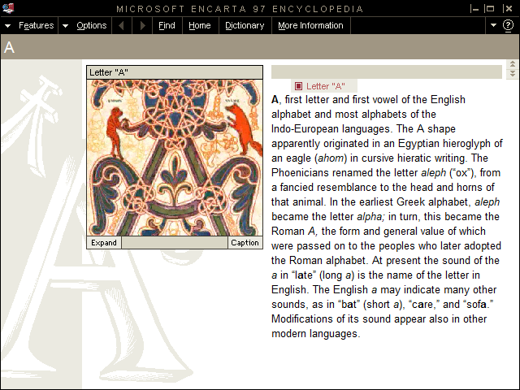
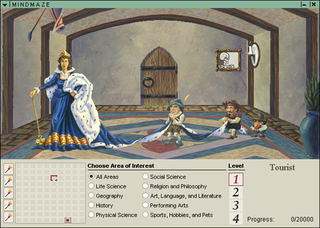
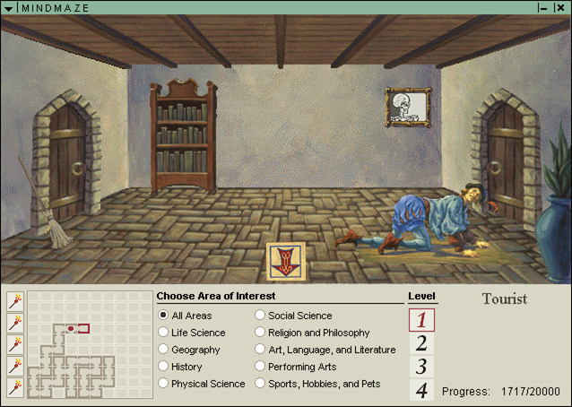
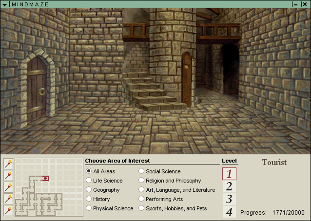
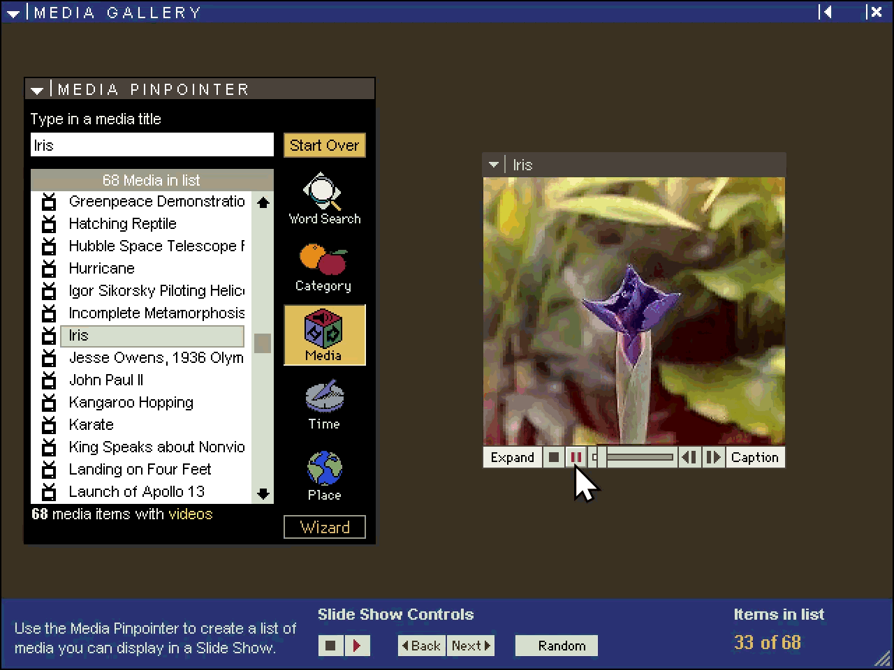
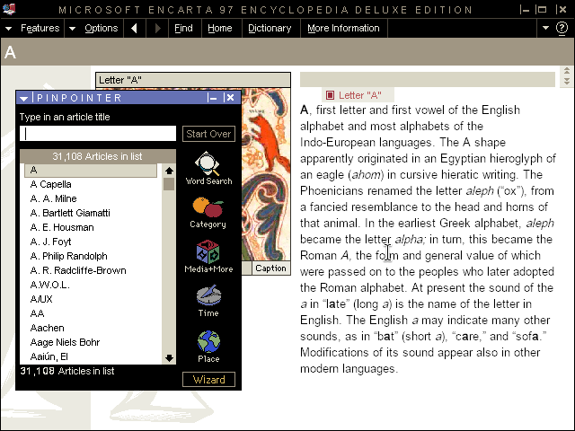

# Encarta 97 Encyclopedia — Static Recompilation Project

Microsoft Encarta 97 Encyclopedia (English, 2-CD Deluxe) statically recompiled:
its x86 is mechanically translated to C that runs on Windows 10/11, and on Linux
and macOS under Wine. You supply the discs; nothing of the product is in this
repository.

Part of the [pcrecomp](https://github.com/sp00nznet/pcrecomp) family of PC
recompilation projects, and follows their shared house style: generated source
is never distributed, a conformance harness guards what works, and a headless
mode records runs without a window.

## Status

**Alpha, no tagged release yet.** The recompiled application boots, browses
articles, plays MindMaze, shows pictures and plays video, but it is still a
*hybrid*: the recompiled app body calls Microsoft's own MFC40, MSVCRT40 and
EEUIL10 underneath ([ROADMAP.md](ROADMAP.md)).

**Conformance: 9 of 9** checks pass (`tools/regress.py`, recorded in
[`conformance.json`](conformance.json) on a machine with the disc; CI has no disc
and reports them as skipped).

| Platform | How | State |
|---|---|---|
| Windows 10/11 | MSVC or clang-cl, Win32 | everything below works |
| Linux | cross-built with clang-cl, run under Wine | boots; articles and pictures render; no video yet ([docs/porting.md](docs/porting.md)) |
| macOS | the same cross build, run under CrossOver | builds in CI; **not yet run on a Mac** |
| Data tools (`m20dump`, `ftcdecode`, ...) | native C | build on Linux, macOS and Windows |

On Windows, driven interactively against the real disc:

| | |
|---|---|
| Article browsing, text, inline artwork | works |
| Search, Dictionary, the media archive | works |
| **Audio** — narration clips, background music, MindMaze effects | works |
| **MindMaze** — category select, levels, scoring, progression | works |
| **Article pictures** (SPAM media) | works — needs `AM16`/`AMF16`, see below |
| **Video** — clips play in the Media Gallery | works |
| Running with no disc in the machine | works — [`tools/localcontent`](tools/localcontent/README.md) |

**Article pictures** initially failed with *"Encarta is not set up properly"*
(ENCTITLE.DLL string 25). Imagery comes through **SPAM**, Encarta's media
content system, and its interface DLL statically imports `AM16.DLL` /
`AMF16.DLL`. Despite the names those are **PE32, not 16-bit** — Setup copies
them to System32, so an uninstalled copy simply lacks them and ENCTITLE cannot
load at all. They ship on CD1 at `AAMSSTP\SYSTEM32\`; copy them beside
`ENC97.EXE` (the harness puts that directory on the DLL search path) and
pictures resolve.

**Video** was the largest single obstacle and is worth stating in full. All 68
clips are **Indeo 3.2** (`IV32`). Microsoft removed the Indeo codecs from
Windows years ago and the CD ships only the *16-bit* driver
(`AAMSSTP\SYSTEM16\IR32.DLL`), which a 32-bit process cannot load. So the driver
itself was statically recompiled, and it is exact: **68 of 68 first frames
decode to 100.00% identical pixels** against FFmpeg, and the RGB frame
`ICM_DECOMPRESS` hands back matches at correlation 1.0000.

It is also wired up. Encarta plays video through MCI, so MCIAVI runs in the
app's own process and asks Video for Windows for an `IV32` decompressor.
`ir32vfw.dll` registers the recompiled codec with `ICInstall`:

```
video: IV32 registered (H:\AAMSSTP\SYSTEM16\IR32.DLL); ICLocate finds it
```

Nothing is hooked and the app is not modified. Every pixel came out of a 16-bit
driver Windows cannot load, translated to C and called back through Video for
Windows — and nothing else on the machine could have produced it, because
`Drivers32` registers cvid, iyuv, mrle, msvc, msyuv and tsbyuv, and no Indeo at
all. Timing has room to spare: the clips are 10 fps and the codec decodes at
59 fps (17 ms a frame against a 100 ms budget). Audio is a separate stream that
MCIAVI plays itself and the video codec never touches.

## Screenshots



The encyclopedia is **navigable**, not a static screenshot. Below is MindMaze,
Encarta's trivia game, played from the recompiled binary — rooms render, the
maze map fills in as you explore, and scoring accumulates across the run:





**Video plays too.** All 68 clips, decoded by the CD's own 16-bit Indeo driver
recompiled to C and handed back to Video for Windows — here the Media Gallery
playing *Rodeo*, one of the 68:



Note that the interface keeps its own colours throughout. An earlier build let
the clip's palette leak into the UI chrome, because the codec advertised 8- and
16-bit output it did not actually produce correctly; it now offers 24bpp only.
Measured over the frames above, the toolbar button colour moves by 2, 2 and 6
levels out of 255 — GIF dither noise, not a palette shift.

**On Linux**, the same recompiled harness under Wine 10 on Debian 13, from a
fresh Wine prefix with nothing installed: article "A", its picture decoded by
the recompiled fractal codec, and the Pinpointer listing 31,108 articles.



## Getting Started

**Quick start: not available yet.** The house style asks for a one-click
`Setup.cmd` / `setup.sh`. It cannot be written honestly until the lift stops
needing a function map from IDA or Ghidra, which a setup script cannot make for
you. That is the first item in [ROADMAP.md](ROADMAP.md).

**Step by step:** [docs/GETTING-STARTED.md](docs/GETTING-STARTED.md), six
stages, each useful on its own, with what each one costs. In short:

1. Build the tools, no disc needed ([Building from source](#building-from-source)).
2. Mount or mirror CD1 ([`tools/localcontent`](tools/localcontent/README.md)).
3. Read the text, decode the pictures, check the video codec.
4. Make a function map of your `ENC97.EXE`, lift it, build `recomp_enc97_run`,
   and run it.

You need a legitimate copy of the product, and Python 3.11+ with `pefile`,
`capstone` and `numpy` for the lifter and the checks.

## Usage

Run the application from a mirror of CD1, with nothing installed and no disc:

```powershell
# Windows
tools\localcontent\run-encarta.ps1 -Content G:\encarta97 -Hold
```

```sh
# Linux (Wine) or macOS (CrossOver)
./play.sh /path/to/encarta97-mirror --hold
./play.sh /path/to/encarta97-mirror --headless --record run.mp4   # Linux: Xvfb, no window
```

Check that everything that works still works:

```
py tools/regress.py            # 9 checks; a missing disc is SKIP, never a pass
py tools/regress.py --update   # accept the run as the baseline (conformance.json)
```

Decode a real image from the disc:

```bash
# extract raw images (use -x; the FTC entries are NOT LZ77-compressed, so -d
# would corrupt them), then decode one to PNG through the recompiled codec
m20dump -x "G:\ENCYC97\PICON.M20" -o out_dir
recomp_decode out_dir\T000009D.FSM "" image.png
```

`PICON.M20` holds **11,350 FTC images** (`.FSM`) + 49 shared fractal transform
tables (`.FTT`); all decode to correct full colour through the recompiled codec.

## Building from source

Windows (Visual Studio 2022, CMake 3.20+):

```bash
cmake -B build -G "Visual Studio 17 2022" -A Win32
cmake --build build --config Release
```

Linux and macOS, the Win32 harness and tools, cross-built with clang-cl
([`cmake/clang-cl-x86.cmake`](cmake/clang-cl-x86.cmake)):

```sh
xwin --accept-license --arch x86 splat --output ~/.xwin   # once
./build.sh
```

Linux and macOS, the data tools natively with gcc or clang:

```sh
cmake -S . -B build && cmake --build build
```

A clean clone builds 11 Win32 tools, or 6 natively. Everything lifted from the
product (the ENC97 lift, the DECO_32 and ENCAPI32 lifts, the Indeo codec) is
generated locally from your own copy and gitignored; the targets that need it
appear once it exists. [GETTING-STARTED](docs/GETTING-STARTED.md) covers each.

## Tools

| Tool | Directory | Description | Status |
|------|-----------|-------------|--------|
| `recomp` | `tools/recomp/` | **Static recompilation** of DECO_32 and ENC97.EXE (x86→C) | **Working** ([details](tools/recomp/README.md)) |
| `indeodec` | `tools/indeo/` | Indeo 3 (IV32) demuxer, the recompiled 16-bit `IR32.DLL` codec and its NE runtime | **Byte-exact** — 68/68 frames vs FFmpeg ([details](tools/indeo/README.md)) |
| `localcontent` | `tools/localcontent/` | Mirror the CD and run from a hard disk, disc ejected | Working — 0 CD reads ([details](tools/localcontent/README.md)) |
| `mvbtext` | `tools/mvbtext/` | Article title/text extractor (MVB 2.0) | Titles ✓, prose reads ([details](tools/mvbtext/README.md)) |
| `encextract` | `tools/encextract/` | End-to-end: disc → image gallery + titles + HTML | Working ([details](tools/encextract/README.md)) |
| `m20dump` | `tools/m20dump/` | M20/MVB 2.0 container extractor | Working |
| `decooracle` | `tools/decooracle/` | Faithful DECO_32.DLL bridge; ground-truth oracle | Working |
| `ftcdecode` | `tools/ftcdecode/` | Clean-room FTC/FTT/FIF image decoder | Working ([details](tools/ftcdecode/README.md)) |
| `regress` | `tools/regress.py` | The conformance harness: re-checks everything that works | 9 of 9 |
| `strdump` / `spamdump` / `datdump` | `tools/` | STR, SPAM and DAT dumpers | Working |
| `fifdecode` | `tools/fifdecode/` | Old DLL bridge (wrong export signatures) | Superseded by `decooracle` |

## What has been recompiled

**DECO_32.DLL — done.** The proprietary FTC image codec is **fully statically
recompiled** — all **28 exports** mechanically translated from x86 (incl. x87
FPU) to native C by a purpose-built lifter, a **137-function closure** with zero
unhandled opcodes. Validated **byte-identical** to the original DLL, with **no
original code executed**, and it now runs with **no `DECO_32.DLL` file at all**.

**ENC97.EXE — the whole 1.3 MB MFC app lifts, and the recompiled entry boots
it.** All **7,326 functions** lift to compilable C (0 unhandled opcodes); **974
functions differential-match** the real originals byte-exactly; all **914
imports wire to real code** (MFC40/MSVCRT40 ship in SysWOW64 — the "MFC40 wall"
was a myth). A **real→lifted `__thiscall` trampoline** lets real MFC
virtual-dispatch land in lifted code, with **10,432 function-pointer slots
routed** and `_initterm` routed so 182 static initializers run lifted.

**IR32.DLL — done**, 16-bit NE and byte-exact; see the video section above.

**ENCAPI32.DLL** is also lifted and validated against the real Win32 boundary
(`fGetArticleID`).

The full writeups are in [`tools/recomp/README.md`](tools/recomp/README.md) and
[`tools/indeo/README.md`](tools/indeo/README.md).

## Why?

Encarta 97 was a landmark multimedia encyclopedia — the gold standard of digital
reference before Wikipedia. It shipped as a Win32 application targeting Windows
95/NT, built with MFC 4.0 and MSVC 4.x. On modern Windows 11 it barely runs, due
to 16-bit thunking code (`ENCBOOT.EXE`, `ENC16.DLL`, `MMPLAYER.EXE` are
NE/Win16), removed WinG/Win32s compatibility layers, deprecated multimedia APIs
(ACM streams, custom MCI drivers), proprietary media containers (`.M20`,
`.FIF`/`.FTT`, `.MMM`), palette-based 256-colour display assumptions, and its
MSVCRT40/MFC40 dependencies.

The goal is a clean, modern C/C++ codebase that runs natively and can serve as a
reference implementation for the Encarta data formats.

## Documentation

| | |
|---|---|
| [docs/GETTING-STARTED.md](docs/GETTING-STARTED.md) | Build it, step by step — and what each stage needs that a clone does not have |
| [docs/porting.md](docs/porting.md) | Linux and macOS: what runs, what it took, what is missing |
| [docs/architecture.md](docs/architecture.md) | The parts, what each owns, and how data flows between them |
| [ROADMAP.md](ROADMAP.md) | Where this stands, what is planned, in what order |
| [CHANGELOG.md](CHANGELOG.md) | What changed |
| [docs/FORMATS.md](docs/FORMATS.md) | How the file formats are laid out — M20/MVB, `\|Phrases`, topic entries, FTC/FTT/FIF |
| [docs/INVENTORY.md](docs/INVENTORY.md) | What is on the discs: every binary and data file |
| [tools/recomp/README.md](tools/recomp/README.md) | The x86→C lifter, the hybrid boundary, and how it was validated |
| [tools/indeo/README.md](tools/indeo/README.md) | Recompiling a 16-bit NE video codec, start to finish |

## Credits

The reverse engineering here stands on other people's published work:

- **Kostya Shishkov** and **Alyssa Milburn** — their documentation of the
  FVF/IFS fractal codec family is what made the clean-room FTC decoder
  (`tools/ftcdecode`) possible. The header layout was reverse engineered from
  `DECO_32.DLL`, but the fractal transform itself is their groundwork.
- **[capstone](https://www.capstone-engine.org/)** (BSD-3-Clause) and
  **[pefile](https://github.com/erocarrera/pefile)** (MIT) — the disassembly and
  PE parsing the lifter is built on. Used as libraries, not vendored.
- **Ghidra**, **IDA Pro** and **Resource Hacker** — function boundaries,
  decompilation and resource extraction.
- **[Wine](https://www.winehq.org/)** and **CrossOver** — run the Win32 harness
  on Linux and macOS. Used as programs; nothing from Wine is in this repository.
- **[xwin](https://github.com/Jake-Shadle/xwin)** — fetches the MSVC CRT and
  Windows SDK the cross build links against. The cross toolchain file comes from
  [redalert2-recomp](https://github.com/sp00nznet/redalert2-recomp), contributed
  there by [@cpressland](https://github.com/cpressland).

`DECO_32.DLL` is a fractal image codec Microsoft licensed from **Iterated
Systems**. It is a subject of the work here, not a contributor to it.

Tools and techniques from this project are contributed back to
**[pcrecomp](https://github.com/sp00nznet/pcrecomp)** — in particular
`runtime/hybrid/` (the lifted↔real boundary) and `docs/HYBRID.md`.

## Contributors

Who found and fixed what is in [CONTRIBUTORS.md](CONTRIBUTORS.md). Contributions
are welcome; [CONTRIBUTING.md](CONTRIBUTING.md) says how, and where your code
can and cannot come from.

## License

The project's own code is MIT licensed; see [LICENSE](LICENSE).

That licence covers the tools, the lifter, the runtime and the harness. It does
not cover Microsoft Encarta 97 Encyclopedia: **no original executables, DLLs or
fonts are distributed here, and no source generated from them.** The lifts and
function maps are made on your machine from your own copy and are gitignored.
You need a legitimate copy of the product to use any of this. `DECO_32.DLL`
implements a fractal image codec Microsoft licensed from Iterated Systems; it
is a subject of the reverse engineering here, not a part of it.

Content files are the one exception, and a deliberate one. These files are
derived from the original product and are outside the MIT grant:

| Files | What they are |
|---|---|
| `fif_test/*.ftc`, `*.ftt`, `*.fif` | image fragments extracted from `PICON.M20`, the decoder's test vectors |
| `fif_test/oracle_out/*` | execution traces and pixel CRCs from running the original `DECO_32.DLL` |
| `docs/encarta97-running.png`, `encarta97-linux.png`, `encarta97-video.png` | screenshots of the running program |
| `docs/encarta97-video.gif` | a capture of a clip playing: Encarta's own video content, and the largest file here |
| `docs/mindmaze.png`, `mindmaze2.png`, `mindmaze3.png` | MindMaze; the interface is this build's, the artwork Encarta's |

The test vectors are kept because the decoders cannot be tested without them.
If you are Microsoft and would like any of that removed, open an issue and it
goes.
